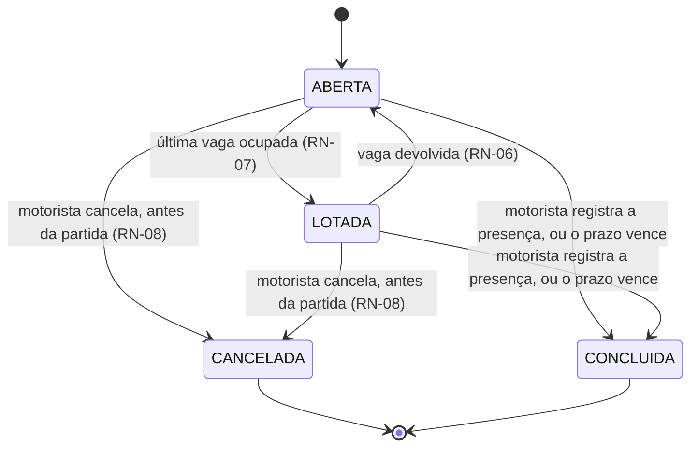

# ViaCar — Débitos Técnicos e Instruções para o Próximo Grupo

> Última revisão: 27/10/2026 (decisão do DT-23)
> Responsável pelo registro: Lucas Rogério Mendonça — Desenvolvedor Backend

Este documento registra atalhos assumidos, limites conhecidos e as armadilhas que já custaram tempo. Se você está pegando o projeto para continuar no N2/N3, **leia a seção 3 antes de escrever qualquer linha** — ela lista o que quebra silenciosamente.

---

## 1. Resolvidos (ficam registrados porque explicam decisões do código)

### DT-01 — RN-01 validada só na aplicação · **RESOLVIDO no D1**

A regra crítica do case (*o motorista não pode oferecer mais vagas do que a capacidade do veículo*) cruza duas tabelas, então `CHECK` do Postgres não alcança. Estava previsto valer só no service.

**Como foi resolvido:** a migration `constraints_regras_negocio` cria a trigger `carona_valida_capacidade`, que barra `INSERT` e `UPDATE` na tabela `carona`. A regra agora vale inclusive para escrita direta no banco — seed, script ou console.

**Verificado:** inserção de 6 vagas em veículo de capacidade 4, direto no `psql`, é rejeitada.

### DT-04 — Sem política de força de senha · **RESOLVIDO**

O cadastro aceitava `12345678`. Agora a senha precisa de 8+ caracteres, ao menos uma letra maiúscula, um número e um caractere especial (`registrarSchema` em `auth.schema.ts`). Vale só no cadastro: senhas já existentes, como a `viacar123` dos usuários do seed, não são revalidadas e continuam funcionando no login.

### DT-08 — Erro de banco chegava como HTTP 500 · **RESOLVIDO no D2**

Descoberto na revisão pré-commit do D2. Violação de constraint chega ao Node de duas formas diferentes:

| Origem | Classe do erro | Reconhecível? |
|---|---|---|
| `UNIQUE`, FK, registro inexistente | `PrismaClientKnownRequestError` | sim, via `code` (P2002, P2003, P2025) |
| `CHECK` e **trigger** | `PrismaClientUnknownRequestError` | não — código e mensagem ficam embutidos no texto |

O segundo caso é justamente o da trigger da RN-01. Sem tratamento, o motorista que tentasse ofertar vagas demais receberia *"Erro inesperado no servidor"* em vez da mensagem correta.

**Como foi resolvido:** `shared/errors/traduzir-erro-do-banco.ts` traduz os dois formatos para o envelope da API. Mensagens de trigger prefixadas com `RN-` são repassadas ao usuário; qualquer outro `CHECK` vira mensagem genérica, para não vazar nome de coluna e de constraint.

### DT-11 — Placa ficava bloqueada para sempre após remover o veículo · **RESOLVIDO**

Achado na revisão anterior ao D3. Como a remoção é lógica (`ativo: false`) e a placa continua ocupando o índice único, o funcionário que removesse o próprio carro levava `409` para sempre ao tentar recadastrá-lo — e o carro nem aparecia na listagem, que filtra `ativo: true`. Beco sem saída.

**Como foi resolvido:** `criar()` agora distingue três casos — placa de outro funcionário (409), veículo próprio ainda ativo (409) e **veículo próprio removido (reativa o registro existente)**.

A reativação mantém o **mesmo `id`** de propósito: um `create` novo dividiria o histórico de caronas entre dois registros do mesmo carro físico.

### DT-12 — Filtro de data divergente entre `atualizar()` e `inativar()` · **RESOLVIDO**

`inativar()` só considerava caronas futuras; `atualizar()` considerava qualquer carona. Combinado com o DT-09 (não existe job que mova `ABERTA` → `CONCLUIDA`), uma carona da semana passada parada em `ABERTA` **travaria a redução de capacidade do veículo para sempre**.

**Como foi resolvido:** os dois métodos usam `caronasFuturasEmUso(veiculoId)`, que centraliza o recorte por status e por data.

### DT-13 — `carona.veiculo_id` sem índice · **RESOLVIDO**

O Postgres não cria índice automático para chave estrangeira (diferente do MySQL), e as duas checagens de "este veículo tem carona?" filtram por essa coluna. Migration `indice_carona_veiculo`. Confirmado com `EXPLAIN`: o planejador usa `carona_veiculo_id_idx`.

### DT-10 — Sem testes automatizados · **RESOLVIDO para D1/D2**

`npm test` retornava exit code 1 (*"No test files found"*), o que deixaria o CI vermelho no primeiro build, e nenhuma rede protegia refatoração.

**Como foi resolvido:** suíte com **143 testes** rodando em ~14 s, contra um **banco de verdade** (`viacar_test`), não contra mocks. A decisão é deliberada: as regras mais críticas — a trigger da RN-01 e o índice parcial da RN-02 — **vivem dentro do banco**, e um mock não provaria nada sobre elas.

| Arquivo | Cobre |
|---|---|
| `tests/shared/horario.test.ts` | Fuso, e a garantia que sustenta o `UNIQUE` da carona |
| `tests/regras-negocio/rn-01-capacidade.test.ts` | Trigger da RN-01, CHECKs, índice parcial, proteção do histórico |
| `tests/regras-negocio/rn-02-concorrencia.test.ts` | Trava contra overbooking e composição em transação |
| `tests/regras-negocio/veiculo.test.ts` | DT-11, DT-12, posse e remoção lógica |
| `tests/regras-negocio/rota.test.ts` | Conversão de horário, posse e remoção com carona agendada |
| `tests/regras-negocio/carona.test.ts` | RN-01 no serviço, RN-03, RN-09, busca e cancelamento |
| `tests/regras-negocio/auth.test.ts` | Cadastro, hash de senha, e a mensagem genérica de login |
| `tests/regras-negocio/reserva.test.ts` | RN-02, RN-04 a RN-07 e RN-10, e a sincronia de status pelo `PATCH` |
| `tests/shared/erros.test.ts` | Tradução de id malformado para 400, em vez de 500 |

**Trava de segurança:** a suíte dá `TRUNCATE` nas tabelas antes de cada teste. Dois pontos do código recusam rodar se `DATABASE_URL` não contiver `_test` — apontar para o banco de desenvolvimento apagaria os dados do dia.

### DT-14 — `prisma/seed.ts` fora da verificação de tipos · **RESOLVIDO**

O `tsconfig.json` incluía apenas `src/**/*.ts`. Como o seed roda via `tsx`, que apaga os tipos sem verificar, um erro de tipo ali só apareceria em execução.

**Como foi resolvido:** o `tsconfig.json` passou a verificar `src`, `tests` e `prisma`, e o `npm run build` usa um `tsconfig.build.json` separado que emite só `src`. Na primeira execução com a nova configuração apareceram **11 erros latentes no seed** — todos corrigidos.

### DT-17 a DT-20 — Bordas encontradas no fechamento do D3 · **RESOLVIDOS**

Quatro defeitos que não aparecem no caminho feliz, todos reproduzidos contra o banco antes da correção.

| ID | Defeito | Correção |
|---|---|---|
| DT-17 | Alterar `rota.horario_partida` entre duas aberturas permitia **duas caronas da mesma rota no mesmo dia** — o índice comparava o instante | Índice passou a comparar o dia-calendário (ver armadilha 3.1) e o service checa por intervalo de dia, não por instante |
| DT-18 | **Rota removida continuava abrindo carona.** A rota sumia da lista do motorista, mas as caronas dela seguiam aparecendo na busca dos colegas | `carregarRotaUtilizavel()` em `carona.service.ts`, espelhando o que já existia para veículo |
| DT-19 | **Datas inexistentes eram aceitas e roladas em silêncio.** `2026-02-30` virava 02/03; `2027-02-29` virava 01/03. O `Date.parse` rola o excedente em vez de recusar | Validação por ida e volta no `carona.schema.ts`: `new Date(...).toISOString().slice(0,10) === valor` |
| DT-20 | **Cancelar carona já partida apagava o histórico.** O cancelamento em cascata marcava as reservas como `CANCELADA`, destruindo o registro de quem de fato viajou — base da pontuação (N2) e da conduta (N3) | `cancelar()` recusa carona cujo `dataPartida` já passou, com mensagem apontando `REALIZADA` / `NAO_COMPARECEU` |

### DT-24 — Fábrica de teste montava placa de tamanho variável · **RESOLVIDO no D4**

`criarVeiculo()` interpolava o contador direto na placa (`TST${n}A${n % 100}`). O contador é do módulo e **não zera entre arquivos de teste**, então ao passar de 99 veículos a placa ficava com 9 caracteres e estourava o `VARCHAR(8)`.

O que torna isso pior do que parece: a falha não aparece em quem causou. Ela aparece em qualquer teste que por acaso rode depois do 99º veículo — no D4 foram 8 testes de reserva falhando com `The provided value for the column is too long`, apontando para `fabricas.ts` e não para a regra sendo testada. Um arquivo de teste novo podia quebrar um arquivo antigo sem encostar nele.

Corrigido com `placaDeTeste(n)`, que gera sempre 7 caracteres no formato Mercosul (LLLNLNN) e continua único até ~1300 veículos por execução.

### DT-25 — Cancelar reserva de carona já partida · **RESOLVIDO no D4**

Mesma raiz do DT-20, na outra ponta: o passageiro podia cancelar a reserva depois da viagem ter acontecido. A linha ia para `CANCELADA` e o registro de que ele **de fato viajou** desaparecia — e é justamente esse registro que alimenta a pontuação (N2) e a avaliação de conduta (N3).

`reserva.service.cancelar()` recusa quando `carona.dataPartida` já passou. Quem faltou é `NAO_COMPARECEU`, e isso é decisão do motorista, não do passageiro.

### DT-26 a DT-30 — Achados da auditoria de fechamento do D4 · **RESOLVIDOS**

Sete hipóteses de defeito levantadas depois do D4 pronto e com a suíte verde, cada uma reproduzida contra o banco antes de virar afirmação. Seis se confirmaram; cinco foram corrigidas e uma virou débito (DT-31).

| ID | Defeito | Correção |
|---|---|---|
| DT-26 | **`PATCH /caronas/:id` não sincronizava o status.** Reduzir vagas até encher deixava a carona `ABERTA` com zero vaga, aparecendo na busca e recusando todo mundo; aumentar vagas numa `LOTADA` não a devolvia para a busca — ela sumia para sempre com o carro pela metade | `atualizar()` recalcula o status pela lotação, nas duas direções (armadilha 3.10) |
| DT-27 | **`atualizar()` não travava a carona.** Reduzir para 1 vaga enquanto uma segunda reserva estava em voo terminava com 2 confirmadas em 1 vaga — a RN-02 furada pela porta do motorista | `$transaction` + `travarCaronaParaAtualizacao`, o mesmo mecanismo já usado na reserva |
| DT-28 | **`cancelar()` da carona não travava a linha.** Uma reserva que entrava durante o cancelamento não era vista pelo `updateMany` da cascata, mas o `update` da carona vencia depois: passageiro `CONFIRMADA` numa carona `CANCELADA`, exatamente o estado que a RN-08 existe para impedir | Transação interativa com a carona travada antes da cascata |
| DT-29 | **Qualquer id malformado na URL virava 500.** Existia desde o D2 em todos os módulos, e passou por três revisões sem ser notado — porque todo teste usava uuid válido | `P2023` e `P2010`/`22P02` no tradutor de erros, viram 400 (armadilha 3.11) |
| DT-30 | **Corpo JSON inválido virava 500.** O `express.json()` lança um `SyntaxError` próprio, que não é `AppError` nem `ZodError` e caía no 500 genérico | `tratarErros` reconhece `entity.parse.failed`, `entity.too.large` e `encoding.unsupported` → 400 |

Também foi removido um trecho de código morto em `reserva.service.criar()`: a rede de segurança da RN-02 tentava corrigir o status antes de recusar, mas a gravação era desfeita pelo `throw` da linha seguinte, junto com a transação. O comentário prometia uma auto-correção que nunca acontecia.

**O que a auditoria confirmou estar certo:** a RN-10 com carona das 22:00 (que é 01:00Z do dia seguinte) trata o dia local corretamente nas duas pontas, e `POST /caronas/:caronaId/reservas` sem token responde 401, não 500.

### DT-06 — Bairro em texto livre quebrava a busca · **RESOLVIDO em parte**

A busca já ignorava maiúsculas (`mode: 'insensitive'`), mas não acentos, abreviações nem pontuação: quem buscava "jd sao joao" não achava a rota cadastrada como "Jardim São João".

**Opções avaliadas:** um cadastro canônico de bairros resolveria também erro de digitação, mas exige tabela, carga inicial com os bairros de Joinville e campo de seleção no frontend. A normalização na entrada resolve as variações que aparecem de fato, sem mudar o contrato da API. Ficou a normalização.

**Como foi resolvido:** a rota ganhou `origem_bairro_chave` e `destino_bairro_chave`, calculadas por `chaveDeBairro()` em `shared/utils/bairro.ts`: minúsculas, sem acento, sem pontuação, abreviação por extenso (`Jd.` → `jardim`, `Vl.` → `vila`, `Pq.` → `parque`...) e sem conectivos (`de`, `da`, `e`...). O texto digitado continua nas colunas originais, para exibir. A busca normaliza o filtro do mesmo jeito e compara chave com chave, por trecho. A migration `chave_de_busca_do_bairro` preencheu as rotas existentes com as mesmas regras em SQL.

**O que ficou aberto:** erro de digitação ("Bucarem" ≠ "Bucarein"). Está na tabela da seção 2.

> **Regra obrigatória:** toda escrita de `origemBairro`/`destinoBairro` grava a chave junto. O `rota.service` faz isso em `paraDadosDoBanco()`, e a fábrica de testes e o seed chamam `chaveDeBairro()` direto. Rota com chave velha some da busca sem erro nenhum. Se mudar as regras de `chaveDeBairro()`, escreva uma migration que recalcule as chaves das rotas existentes.

---

## 2. Débitos abertos

| ID | Débito | Impacto | Como pagar |
|---|---|---|---|
| DT-02 | Listagens sem paginação | Trava com volume real | `?pagina=&limite=` e devolver `total` no corpo |
| DT-03 | JWT sem refresh token | Sessão de 8h morre e o usuário perde o contexto | Endpoint de refresh + rotação |
| DT-05 | Sem rate limit no `/auth/login` | Força bruta sem obstáculo | `express-rate-limit` por IP e por e-mail |
| DT-06 (resto) | Erro de digitação no bairro | "Bucarem" não acha "Bucarein" — a chave de busca resolve grafia, não erro | Cadastro canônico de bairros com seleção na interface, ou `pg_trgm` para aproximar |
| DT-07 | Recorrência de rota é simplificada (`diasSemana`) | Não trata feriado nem exceção | Tabela de exceções de calendário |
| DT-09 | Carona não tem fim: nada grava `CONCLUIDA`, `REALIZADA` nem `NAO_COMPARECEU` | Depois da partida a carona fica sem saída — não cancela (DT-20), a reserva não cancela (DT-25) e tudo fica `CONFIRMADA` para sempre. Sem isso não há o que pontuar (N2) nem avaliar (N3) | **Ciclo de vida definido em 29/10/2026** — ver "DT-09 — Ciclo de vida da carona", logo abaixo. Falta implementar |
| DT-15 | ESLint e Prettier não configurados | A Seção 6.3 do acordo condiciona aprovação de PR ao linter — hoje é inaplicável | `@typescript-eslint` + Prettier + passo no CI (**DevOps**) |
| DT-16 | Sem `helmet` nem cabeçalhos de segurança | Respostas sem proteção básica de browser | `app.use(helmet())` |

### DT-09 — Ciclo de vida da carona

> **Status:** definido em 29/10/2026 · **implementação pendente**
> Esta seção registra a definição. Enquanto o código não mudar, a API **não** se comporta assim: nada grava `CONCLUIDA`, `REALIZADA` nem `NAO_COMPARECEU`.

#### O problema não é só a falta de um job

O registro original falava em "transição na mão". Na prática, **não existe transição nenhuma**, nem manual: nenhum endpoint grava os status de fim de viagem. O efeito aparece já no N1, não só no N2:

- Depois da partida, o motorista não consegue cancelar (DT-20) e o passageiro também não (DT-25), corretamente, para não apagar o histórico. Mas também não há o que fazer no lugar: a carona fica `ABERTA` ou `LOTADA` e as reservas ficam `CONFIRMADA` para sempre.
- A mensagem de erro de `carona.service.cancelar()` manda "encerrar as reservas como realizadas ou não comparecidas", um caminho que não existe.
- O código contorna isso olhando a data em vários lugares (busca, DT-12, rota com carona agendada). Cada novo recurso precisa lembrar de fazer o mesmo.

#### A definição



| Pergunta | Definição |
|---|---|
| Quando a viagem termina? | Quando a carona é **fechada**: o motorista registra a presença, ou vence o prazo de fechamento. A partida em si não muda status nenhum |
| Quem registra a presença? | **O motorista**, marcando cada reserva confirmada como `REALIZADA` ou `NAO_COMPARECEU`. Era o que o DT-25 já registrava. O passageiro não confirma nem contesta |
| Quando pode fechar? | Da `dataPartida` até **7 dias depois**. Antes da partida não há presença a registrar; para desistir antes da partida, o caminho continua sendo cancelar |
| E se o motorista não fechar? | Vencidos os 7 dias, a carona fecha sozinha: vira `CONCLUIDA`, e cada reserva ainda `CONFIRMADA` vira **`SEM_REGISTRO`**, um status novo |
| O que pontua e o que pesa na conduta? | Só `REALIZADA` é evidência de viagem. `NAO_COMPARECEU` alimenta a conduta (N3). `SEM_REGISTRO` **não pontua nem penaliza** |

**Por que `SEM_REGISTRO` e não presumir um dos dois:** presumir `REALIZADA` faria a empresa pagar pontos (que viram voucher de combustível e folga) por viagens que ninguém confirmou. Presumir `NAO_COMPARECEU` sujaria a conduta do passageiro por uma omissão do motorista. Sem evidência, a reserva fica de fora das duas contas.

**Por que sem job agendado:** o fechamento por prazo é materializado **sob demanda**, na transação de quem tocar a carona depois do prazo (o fechamento, a leitura do detalhe, a futura pontuação). A regra é uma função só, e um job diário pode ser acrescentado depois sem mudar nada dela. Isso também evita mais um processo para o DevOps operar.

**`EM_ANDAMENTO` não é gravado.** "Já partiu" sai de `dataPartida`. Gravar estado derivado foi exatamente o que gerou a armadilha 3.10, e sem GPS o sistema não sabe se a viagem está de fato em andamento. O valor continua no enum, porque removê-lo exige migration destrutiva, mas nenhum código deve escrevê-lo.

#### O que ficou de fora, deliberadamente

- **Corrigir a marcação depois de fechar.** `CONCLUIDA` é terminal, como já é hoje. Se aparecer demanda, é uma decisão nova, porque mexe em pontos já creditados.
- **Motorista que não apareceu.** Ele não consegue cancelar depois da partida e, se não fechar, a carona termina com tudo em `SEM_REGISTRO`: ninguém pontua e ninguém é punido. Registrar a falta do motorista é assunto da avaliação de conduta (N3).
- **Quanto vale uma viagem.** Continua sendo a Q-04 de `requisitos.md`.

#### Para quem for implementar

1. **Migration:** `SEM_REGISTRO` no enum `StatusReserva`. Só acrescenta, não altera nada que existe.
2. **Uma função que responde "esta carona está fechada?"** (status terminal **ou** prazo vencido) e uma que materializa o fechamento por prazo. Todo lugar que hoje decide pela data passa a perguntar a ela.
3. **Endpoint de fechamento** (sugestão: `POST /caronas/{id}/concluir`, com a presença de cada reserva confirmada). Ele deve:
   - recusar fora da janela;
   - exigir que **todas** as reservas confirmadas venham marcadas, nem mais nem menos;
   - aceitar lista vazia quando ninguém reservou;
   - rodar com a carona **travada**, porque é o quarto escritor de status (armadilha 3.10).
4. **Mensagem de `cancelar()`:** passa a apontar o fechamento, que agora existe.
5. **Frontend:** rótulo para `SEM_REGISTRO` (os outros status já têm, em `App.tsx`) e a tela de registro de presença.
6. **Testes:** as duas pontas da janela (no instante da partida, e 7 dias depois); fechamento parcial recusado; fechamento por prazo materializado na leitura; carona sem reserva; e que `CONCLUIDA` não reabre.

### Achados das revisões de fechamento, adiados de propósito

Levantados nas revisões de fechamento do D3 e do D4 e classificados como recomendados, não obrigatórios. **Decisão do time: fazer depois que todas as fases estiverem entregues**, para não gastar tempo de implementação em polimento antes da N1.

| ID | Débito | Onde | Impacto | Como pagar |
|---|---|---|---|---|
| DT-21 | Dois `as Prisma.RotaUncheckedCreateInput` / `UncheckedUpdateInput` | `rota.service.ts:62` e `:93` | São os **únicos** escapes do TS estrito no projeto inteiro. Se o helper genérico `paraDadosDoBanco` divergir do tipo do Prisma, o compilador fica calado | Tipar `paraDadosDoBanco` com o tipo de entrada correto e remover as duas asserções |
| DT-22 | `rota.service.atualizar()` não verifica `ativa` | `rota.service.ts` | Dá para editar uma rota já removida. Inofensivo hoje porque rota inativa não abre carona (DT-18), mas é inconsistente com `criar` | Espelhar a checagem de `carregarRotaUtilizavel()` |
| DT-31 | RN-10 não resiste a concorrência | `reserva.service.ts` | Duas reservas simultâneas em caronas **diferentes** travam linhas diferentes, então nenhuma enxerga a outra e as duas passam. Não tem índice sustentando a regra, como tem no caso da reserva duplicada na mesma carona. Exige a mesma pessoa clicando em duas caronas no mesmo instante, e a RN-10 era opcional no N1 | Índice parcial por `(passageiro, dia, sentido)`, ou um lock por passageiro antes do lock da carona — nessa ordem, sempre, senão dá deadlock |
| DT-23 | Visibilidade de `passageiros` não restringida | `GET /caronas/{id}`, `openapi.ts` | Qualquer funcionário autenticado vê a lista completa de passageiros de qualquer carona, inclusive de caronas já encerradas | **Política decidida pelo PO em 27/10/2026** — ver a seção 2.1. Falta implementar e documentar no Swagger |
| DT-32 | Reserva não avisa quem verá o ponto de embarque | `frontend` — formulário de reserva | O passageiro informa um endereço de rua sem saber quem o verá. O DT-23 define quem acessa; não cobre o consentimento de quem digita. Decisão de produto, não de backend | Uma linha no formulário com o texto aprovado pelo PO |

> A outra metade do DT-23 — registrar no Swagger que `GET /caronas` filtra `status = ABERTA` e portanto esconde as `LOTADA`, não só as `CANCELADA` — **foi feita no D4**, junto com a documentação das reservas.

---

### 2.1 DT-23 — Política de visibilidade de passageiros

> **Status:** decidida pelo PO em 27/10/2026 · **implementação pendente**
> Esta seção registra a decisão. Enquanto o código não mudar, o comportamento descrito aqui **não** é o que a API faz — ela continua entregando a lista completa a qualquer autenticado.

#### O que mudou o enquadramento

`passageiros` não é um campo, são três sensibilidades. `nome` e `bairro` estão perto de dado de diretório interno — o do motorista, aliás, já sai em todo resultado de busca. Mas `pontoEmbarque` é endereço de rua amarrado a uma pessoa nomeada, numa data e hora conhecidas.

Some-se a isso que `buscarPorId` não filtra status nem data: uma carona concluída há meses continua respondendo. Como `GET /caronas` devolve os `id` das caronas abertas, o risco real nunca foi a consulta isolada — é a **agregação**: varrer ids e montar o padrão de deslocamento dos colegas.

#### A decisão

**Visibilidade por vínculo com a carona, não por autenticação.**

A assimetria que sustenta isso: o motorista **publica** a carona para ser encontrado, e por isso o resumo dele circula na busca. O passageiro não publicou nada para a empresa inteira — entrou numa viagem específica, e o consentimento dele tem o escopo daquela viagem.

| Quem pede | O que recebe em `passageiros` |
|---|---|
| Motorista da carona | Nome completo, bairro e ponto de embarque de todos |
| Passageiro confirmado nela | Nome completo e bairro dos demais; ponto de embarque só o próprio |
| Qualquer outro funcionário | Primeiro nome e bairro, sem `id` e sem ponto de embarque |
| Qualquer outro, carona já encerrada | O campo `passageiros` não vem |

Encerrada = `CANCELADA`, `CONCLUIDA`, ou `dataPartida` no passado. **A data entra na conta** porque o status não é varrido por job (DT-09): sem ela, uma carona de março continuaria `ABERTA` no banco e passaria por futura.

#### Três detalhes que não são óbvios

- **O `id` do passageiro não sai** para quem não participa. Ele correlaciona a mesma pessoa entre caronas diferentes, o que anularia o primeiro nome como redução.
- **O campo é omitido, não vazio**, quando ninguém pode vê-lo. Lista vazia significaria "ninguém reservou", que é outra informação. `vagasDisponiveis` segue público em todas as camadas e já diz quantos entraram.
- **Primeiro nome é redução, não anonimato.** Numa empresa pequena, "Ana" + bairro ainda identifica. Serve ao caso de uso que justificava a abertura — *tem alguém que eu conheço nessa carona?* — sem entregar a lista nominal. O Swagger não deve vender isso como anonimização.

#### O que ficou de fora, deliberadamente

Não houve validação com DPO, jurídico ou RH: o ViaCar não tem cliente real no N1. A política fica registrada como premissa do time (`requisitos.md` §9), a ser reconfirmada se o produto sair do contexto acadêmico.

#### Para quem for implementar

Custo de interface esperado: **zero**. O frontend não consome `carona.passageiros` (verificado em `App.tsx`, `api.ts` e `types.ts`); o ponto de embarque que a tela mostra vem de `GET /reservas` (RF-15).

Caminho sugerido: `buscarPorId` passa a receber o solicitante — o controller já tem `usuarioLogado(req)`, só não repassa — decide a camada no service e aplica o recorte em `paraDetalhada()`, num único lugar onde se leia o que cada camada entrega. `exigirPosse()` já serve de modelo de verificação.

A suíte precisa cobrir as quatro camadas e as duas pontas do histórico: o que este endpoint esconde não aparece em nenhuma tela, então, se a exposição voltar numa refatoração, só o teste percebe.

---

## 3. ⚠️ Armadilhas — leia antes de programar

São comportamentos **verificados empiricamente**, não suposições. Cada um já foi testado contra o banco real.

### 3.1. A unicidade da carona é por DIA, e vive fora do `schema.prisma`

"Uma carona por rota por dia" é garantida pelo índice `carona_unica_por_rota_e_dia`, criado à mão na migration homônima:

```sql
CREATE UNIQUE INDEX "carona_unica_por_rota_e_dia"
  ON "carona" ("rota_id", (("data_partida" AT TIME ZONE INTERVAL '-03:00')::date))
  WHERE "status" <> 'CANCELADA';
```

Três decisões embutidas aí, todas com motivo:

1. **Compara o dia-calendário, não o instante.** A versão anterior era `UNIQUE (rota_id, data_partida)` e tinha furo: bastava alterar `rota.horario_partida` entre duas aberturas para o mesmo dia aceitar duas caronas. Verificado contra o banco antes da correção.
2. **Ignora canceladas.** Sem isso, cancelar uma carona bloquearia aquele dia para sempre — reabrir geraria o mesmo instante e esbarraria na constraint.
3. **O fuso entra como `INTERVAL`, não como nome.** `AT TIME ZONE 'America/Sao_Paulo'` é `STABLE`, e o Postgres recusa expressão não-`IMMUTABLE` em índice. O offset fixo é correto porque o Brasil extinguiu o horário de verão em 2019.

> **Regras que continuam valendo:** `POST /caronas` recebe `data` como `"AAAA-MM-DD"`, nunca um instante — `"2026-09-15T22:00-03:00"` cai no dia 16 em UTC. E `data_partida` é sempre recomposta com `combinarDiaEHorario()` a partir de `rota.horario_partida`, nunca copiada do cliente.

**Não tente mover esse índice para o `schema.prisma`:** o Prisma não expressa índice único parcial nem índice sobre expressão.

### 3.2. Veículo inativado continua encontrável por id

`GET /veiculos/:id` não filtra `ativo`, o que é correto — caronas passadas precisam exibir o carro. Mas significa que **nada impede publicar carona com veículo já removido**.

> **Regra obrigatória:** ao criar carona, validar `veiculo.ativo === true` além da posse. A trigger do banco não cobre isso.

**Implementado no D3** em `carregarVeiculoUtilizavel()`, dentro de `carona.service.ts`, que checa existência, posse (RN-03) e `ativo` numa função só. Coberto por `carona.test.ts` ("recusa usar veículo já removido").

### 3.3. Hora do dia é `TIME`, não string

`rota.horario_partida` é `TIME` no Postgres. O Prisma devolve `Date` ancorado em `1970-01-01`. Testado em máquina UTC-3: o round-trip com `shared/utils/horario.ts` preserva `"07:30"` corretamente.

> **Regra obrigatória:** sempre converter com `horaParaTexto()` e `textoParaHora()`. Nunca formatar esse `Date` com `toLocaleTimeString()` ou com a data completa — aí sim o fuso entra e o horário anda.

### 3.4. Nunca valide query string escrevendo em `req.query`

No Express 5 `req.query` é um **getter**. Atribuir nele não lança erro — e também não tem efeito. Testado:

```json
{ "atribuicaoDireta": "permitida", "queryDepois": { "a": "1" } }
```

Ou seja: a validação rodaria, mas o valor normalizado pelo Zod (números convertidos, datas parseadas, defaults aplicados) seria **descartado em silêncio**, e o controller continuaria lendo strings cruas.

> **Regra obrigatória:** use `validarQuery(esquema)` na rota e `consultaValidada<T>(req)` no controller. O middleware escreve em `req.consulta`.

### 3.5. `vagasDisponiveis` é calculado, nunca coluna

`vagasOfertadas - COUNT(reservas CONFIRMADA)`. Não crie coluna para isso: ela dessincroniza no primeiro cancelamento.

### 3.6. A RN-02 precisa de transação com lock

Duas pessoas reservando a última vaga ao mesmo tempo passam as duas por um `if (count < vagas)` ingênuo.

> **Regra obrigatória:** `prisma.$transaction` com `SELECT ... FOR UPDATE` na linha da carona antes de contar e inserir. O índice parcial `reserva_confirmada_unica_por_carona` é a rede de segurança, não a solução — ele impede reserva duplicada do mesmo passageiro, não o overbooking entre passageiros diferentes.

**Medido contra o banco**, 4 pessoas disputando 1 vaga ao mesmo tempo:

| | Reservas confirmadas |
|---|---|
| Checagem ingênua (`if confirmadas < vagas`) | **4 para 1 vaga** |
| `$transaction` + `FOR UPDATE` | **1** |

**A ferramenta já existe:** `travarCaronaParaAtualizacao(tx, caronaId)` e `contarReservasConfirmadas(caronaId, db)`, em `carona.service.ts`. Coberto por `rn-02-concorrencia.test.ts`.

### 3.7. Nunca chame um service com o singleton de dentro de uma transação

`prisma.algumaCoisa()` executado dentro de `prisma.$transaction(async (tx) => ...)` roda **fora** da transação. O lock não protege aquela consulta, e o defeito só aparece sob concorrência.

> **Regra obrigatória:** toda função que pode ser chamada de dentro de uma transação recebe `db: ClientePrisma = prisma` como último parâmetro e usa `db`, nunca `prisma`. Já seguem esse padrão: `carregarCarona`, `carregarDoDono`, `contarReservasConfirmadas` e `carregarDoMotorista`.

### 3.8. Nada é apagado de verdade

Não existe `onDelete: Cascade` em lugar nenhum do schema — de propósito. Usuário e veículo são desativados (`ativo = false`). Apagar em cascata destruiria o histórico de caronas, que é exatamente a base da pontuação (N2) e da avaliação de conduta (N3).

> Tentar `DELETE` num usuário com histórico devolve `P2003` e é traduzido para HTTP 409. Isso é o comportamento desejado, não um bug.

### 3.9. Os status `REALIZADA` e `NAO_COMPARECEU` não são decoração

`StatusReserva` já prevê os dois. Eles existem para alimentar pontos e conduta no N2/N3. **Não remova do enum** — remover exige migration destrutiva depois.

### 3.10. `carona.status = LOTADA` é derivado, mas fica gravado — e precisa voltar

`vagasDisponiveis` é calculado (armadilha 3.5). `status` **não é**: `LOTADA` é uma coluna, e existe porque `GET /caronas` filtra por `status = ABERTA` no banco, sem conseguir contar reservas na cláusula `WHERE`.

Ser derivado e gravado ao mesmo tempo cria duas obrigações, e a armadilha está em achar que é só uma.

**Primeira: reavaliar nas duas direções.** Quem implementa só a ida deixa a carona presa em `LOTADA` para sempre — ela some da busca e não volta nem com o carro vazio.

**Segunda, e é a que me pegou: são TRÊS escritores, não dois.** A primeira versão desta armadilha listava só os dois do módulo de reservas e esqueceu que o motorista também mexe na lotação, alterando `vagasOfertadas`. O resultado foi carona `ABERTA` com zero vaga aparecendo na busca, e carona `LOTADA` com duas vagas livres invisível para sempre.

| Quem mexe na lotação | Onde | Regra |
|---|---|---|
| A última vaga é ocupada | `reserva.service.criar()` | RN-07 |
| Uma vaga é devolvida | `reserva.service.cancelar()` | RN-06 |
| **O motorista muda `vagasOfertadas`** | `carona.service.atualizar()` | as duas, conforme a conta |

Por isso a decisão vive numa função só, `carona.service.statusPelaLotacao()`, e os três chamam ela. Se aparecer um quarto escritor — um job de status, um cancelamento em massa —, ele chama também. **Não reimplemente a conta no lugar novo.**

As três rodam dentro da transação que faz a mudança, com a carona travada: sem o lock, o status decide com base numa contagem que já mudou. E status terminal não reabre — uma carona `CONCLUIDA` ou `CANCELADA` não volta para `ABERTA` porque alguém desmarcou.

Os testes que seguram isso: `RN-07 — a carona fecha sozinha ao encher`, `RN-06 — cancelar reserva devolve a vaga` e `RN-06 e RN-07 pela porta do motorista — PATCH muda a lotação`.

### 3.11. Id de rota malformado não chega no banco como erro bonito

`req.params.id` é texto puro. `/veiculos/abc` chega no Prisma, que recusa o cast para uuid — e isso **não** é um erro de "não encontrado", é um erro de driver. Vinha como 500 até o D4.

São dois códigos diferentes, porque são dois caminhos diferentes até o banco:

| Origem | Código | Onde acontece |
|---|---|---|
| ORM (`findUnique`, `update`…) | `P2023` | qualquer módulo |
| `$queryRaw` com `::uuid` | `P2010` + `meta.code = 22P02` | o `FOR UPDATE` da RN-02 |

Os dois são tratados em `traduzir-erro-do-banco.ts` e viram **400 VALIDACAO**, não 404: o id não existe *como id*, então dizer "não encontrado" mandaria o frontend procurar um problema que não é dele. Ao criar um endpoint novo com parâmetro de rota, não precisa validar uuid no controller — o tradutor já cobre.

---

## 4. Por onde começar o N2/N3

O DER das tabelas de evolução (`EXTRATO_PONTOS`, `AVALIACAO`, `RESGATE`) já está desenhado em [modelagem-dados.md](modelagem-dados.md), seção 4, com as decisões justificadas — inclusive por que saldo de pontos é derivado do extrato e não coluna em `usuario`.

A estrutura em módulos (`controller` → `service` → Prisma) foi montada para que pontuação e avaliação entrem como módulos novos, sem reescrever o que existe. Regra de negócio mora no `service`; se você está escrevendo `if` de negócio dentro de um `controller`, parou no lugar errado.

### Se você quer um primeiro commit pequeno antes de encarar o N2

Pegue o **DT-31**. É o único débito aberto que já vem com o diagnóstico fechado e o caminho escrito, e ele obriga a passar pelas duas coisas que mais importam neste código: transação com lock e teste de concorrência contra banco real.

O defeito: a RN-10 impede duas reservas confirmadas no mesmo dia e sentido, mas não resiste a concorrência. Cada reserva trava a linha da *sua* carona — caronas diferentes, linhas diferentes, então as duas passam. Está reproduzido: duas reservas simultâneas, ambas aceitas.

O caminho sugerido é travar o passageiro antes da carona, no começo de `reserva.service.criar()`:

```ts
await tx.$queryRaw`SELECT id FROM usuario WHERE id = ${passageiroId}::uuid FOR UPDATE`;
```

**A ordem é a parte que importa:** usuário, depois carona — sempre, em qualquer transação que precise dos dois. Hoje nada no projeto trava carona e depois usuário, então não há ciclo; inverter a ordem em um lugar só é o que cria deadlock. Antes de dar por pronto, meça: duas reservas do mesmo passageiro em caronas diferentes ao mesmo tempo devem terminar em 1, e duas pessoas diferentes na mesma carona devem continuar terminando em 1 — se esta segunda virar 0 ou travar, o lock ficou largo demais.

Leia a armadilha 3.6 antes. O padrão de teste de concorrência já existe em `tests/regras-negocio/rn-02-concorrencia.test.ts`, é só copiar.
